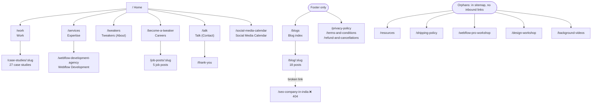

# Minimal Tweaks — Sitemap & Information Architecture

> Source: full crawl of https://minimaltweaks.com on 2026-11-03 (sitemap.xml + link-following from every page).
> Companion file: [`page-inventory.csv`](./page-inventory.csv) — one row per URL with title, H1, meta description and inbound-link counts.

The revamp **keeps this sitemap and every existing URL**. The page tree, URL slugs and section groupings below are the contract for the new build. Anything marked **⚠ Decision** needs a call from the team before build; it does not change the sitemap unless approved.

---

## 1. Current site at a glance

| | |
|---|---|
| Platform | Webflow (hosted, Cloudflare in front) |
| Total URLs | **68** in `sitemap.xml` (+1 broken URL found by crawling) |
| Static pages | 19 |
| CMS detail pages | 27 case studies · 18 blog posts · 5 job posts |
| Hidden pages | None. Every internal link resolves to a sitemap URL, except one 404 |
| Primary conversion | Contact / lead forms (one on almost every page) → `/thank-you` |
| Analytics | Google Tag Manager `GTM-5R542TZ` |

---

## 2. Sitemap



### 2.1 Full page tree

```
/                                   Home
├── /work                           Work — case-study index (filterable)
│   └── /case-studies/:slug         27 case-study pages
├── /services                       Expertise — all services
│   └── /webflow-development-agency Webflow Development (service landing page)
├── /tweakers                       Tweakers — about / team / culture
├── /become-a-tweaker               Careers — job listing
│   └── /job-posts/:slug            5 job pages
├── /talk                           Talk — contact
│   └── /thank-you                  Form success page
├── /social-media-calendar          Lead magnet: 2023 social media calendar
├── /blogs                          Blog index  (note: index is /blogs, posts are /blog/…)
│   └── /blog/:slug                 18 blog posts
├── /resources                      Resources hub (orphaned)
├── /webflow-pro-workshop           Event: WebflowPro workshop (orphaned)
├── /design-workshop                Event: prototyping workshop — placeholder "Lorem Ipsum" content (orphaned)
├── /background-videos              Utility page, no content/nav (orphaned)
└── Legal
    ├── /privacy-policy
    ├── /terms-and-conditions
    ├── /refund-and-cancellations
    └── /shipping-policy            (orphaned)

robots.txt also disallows /lp/ (campaign landing pages; none are linked or in the sitemap).
```

### 2.2 CMS collections (template-driven pages)

| Collection | URL pattern | Count | Listed on | Detail page links to |
|---|---|---|---|---|
| Case Studies | `/case-studies/:slug` | 27 | `/work` (all 27), Home (4 featured), Webflow Dev page (6) | 3 other case studies ("Have a look at other case studies") |
| Blog Posts | `/blog/:slug` | 18 | `/blogs` (all 18), Home (2) | Related blogs, `/webflow-development-agency`, broken `/seo-company-in-india` |
| Job Posts | `/job-posts/:slug` | 5 | `/become-a-tweaker` (all 5) | The other 4 jobs; external ClickUp application form |

Full lists of case studies, blog posts and jobs are in `page-inventory.csv`.

---

## 3. How pages link to each other

### 3.1 Global navigation (identical on every page except 2 utility pages)

| Header nav | URL |
|---|---|
| Logo | `/` |
| Work. | `/work` |
| Expertise. | `/services` |
| Tweakers. | `/tweakers` |
| Careers. | `/become-a-tweaker` |
| Talk. | `/talk` |
| Social Media Calendar. | `/social-media-calendar` |

There is also a second mobile/menu set with **Us.** and **Expertise.** entries that both point to `/`. ⚠ That's a bug, or they were meant to be anchors.

### 3.2 Footer (identical on every page)

| Column | Links |
|---|---|
| Services | Social Media Marketing → `/#service-cards` · Branding & Identity → `/#` (dead) · Webflow Development → `/webflow-development-agency` · UI/UX Designing → `/#service-cards` |
| Help & Advice | Blogs → `/blogs` · Privacy Policy · Terms and Conditions · Refund & Cancellations |
| Company | Expertise → `/services` · Tweakers → `/tweakers` · Become a Tweaker! → `/become-a-tweaker` · Work → `/work` · Contact Us → `/talk` |
| Get in touch | Address (Unitech Cyber Park, Gurugram) · phone · hello@minimaltweaks.com · "How We Tweak?" YouTube video |
| Social | Instagram · LinkedIn · Twitter/X · YouTube · WhatsApp · Webflow profile |

### 3.3 In-content link flows (body links only, nav and footer excluded)

```
Home ──► /services (×4 service cards) ──► /talk
     ──► /webflow-development-agency (×2)
     ──► 4 featured case studies
     ──► 2 blog posts, /blogs, /social-media-calendar, /work, /talk

/work ──────────────► all 27 case studies
/case-studies/* ────► 3 other case studies     (no in-body CTA to /talk or /services ⚠)
/webflow-development-agency ──► 6 case studies, 1 blog post
/blogs ─────────────► all 18 posts
/blog/* ────────────► related posts, /webflow-development-agency, /social-media-calendar
/become-a-tweaker ──► all 5 jobs ──► other jobs + external ClickUp form
/tweakers ──────────► /work, /talk
/social-media-calendar ──► /blogs, Google Calendar (external), Product Hunt (external)
```

**Key observations**
- Case-study pages are dead ends for conversion. Their only body links go to other case studies, so the contact path relies on the global contact form.
- `/webflow-development-agency` is the only service with its own page. Every other service (SMM, Branding, UI/UX, Performance Marketing) lives as a section of `/services`.
- Blog posts link into Webflow Dev, but no blog post links to `/services`.

---

## 4. Issues found (fix during the revamp, URLs unchanged)

| # | Issue | Where | Fix in revamp |
|---|---|---|---|
| 1 | **Broken internal link** to `/seo-company-in-india` (404) | Every one of the 18 blog posts (shared template link "used"), plus inline links in 3 posts | Remove it, or ⚠ Decision: build the SEO service page at that URL |
| 2 | **6 orphan pages** with no inbound links | `/resources`, `/shipping-policy`, `/webflow-pro-workshop`, `/design-workshop`, `/background-videos`, `/thank-you` (fine as a form target) | ⚠ Decision for each: keep and link it, keep as unlinked landing page, or noindex |
| 3 | Placeholder "Lorem Ipsum" page is live and indexable | `/design-workshop` | Finish the content or noindex it |
| 4 | **www and apex both serve 200, no canonical tags** → duplicate content | Site-wide | 301 www → apex (the sitemap uses apex) and add a self-referencing canonical on every page |
| 5 | Mixed internal link hosts (`https://www.…` vs relative) | Home case-study cards, others | Relative internal links only |
| 6 | Dead nav and footer links | "Us." and "Expertise." in the menu → `/`; "Branding & Identity" → `/#` | Point them to real destinations |
| 7 | Missing meta descriptions on 9 pages | Legal pages, `/resources`, workshops, `/thank-you`, `/background-videos` | Add them, or noindex the utility pages |
| 8 | Pages with 0 or multiple H1s | 12 pages, incl. `/work`, `/talk`, `/tweakers`, `/blogs`, all job posts | Exactly one H1 per page, enforced in templates |
| 9 | Missing OG images | 9 pages | Default OG image plus a per-page override field |
| 10 | Duplicate "Help & Advice" cards repeated twice in markup | `/services` | Render once |
| 11 | Stale content dated 2022–2023 | "…in 2022" blog posts, "Social Media Calendar 2023" | ⚠ Decision: refresh the copy but keep the slugs |
| 12 | Inconsistent index naming: `/blogs` lists `/blog/*` | Blog | Keep both URLs (SEO). Add breadcrumbs so the relationship is clear |

---

## 5. Target architecture for the revamp

### 5.1 Principles
1. **URL parity.** Every one of the 68 URLs resolves at the same path with a 200. No slug changes. A redirect map exists only for host normalisation and the 404 above.
2. **Template-driven.** 7 templates cover all 68 pages (§5.3).
3. **Content in a CMS, not in code**, for case studies, blog posts, jobs, testimonials, clients, FAQs and services.
4. **Every page ends in a next step.** Each template has a defined primary CTA and cross-links (§5.5).

### 5.2 Route map (framework-agnostic)

| Route | Template | Data source |
|---|---|---|
| `/` | Home | Singleton + featured case studies, services, blog posts, clients, testimonials, FAQs |
| `/work` | Work index | Case Studies (filter by service category) |
| `/case-studies/[slug]` | Case study | Case Studies |
| `/services` | Services overview | Services |
| `/webflow-development-agency` | Service landing | Services (Webflow) + case studies tagged Webflow + FAQs + testimonials |
| `/tweakers` | About | Singleton + team / values + clients |
| `/become-a-tweaker` | Careers index | Job Posts |
| `/job-posts/[slug]` | Job post | Job Posts |
| `/talk` | Contact | Singleton + contact form |
| `/thank-you` | Utility (noindex) | Static |
| `/blogs` | Blog index | Blog Posts (filter by category) |
| `/blog/[slug]` | Blog post | Blog Posts |
| `/social-media-calendar` | Lead magnet | Singleton |
| `/resources` | Resources hub | Singleton (⚠ Decision: keep) |
| `/webflow-pro-workshop`, `/design-workshop` | Event landing | Singleton per event (⚠ Decision: keep) |
| `/background-videos` | Utility | ⚠ Decision: likely drop or noindex |
| `/privacy-policy`, `/terms-and-conditions`, `/refund-and-cancellations`, `/shipping-policy` | Legal | Rich-text singleton each |
| `/sitemap.xml`, `/robots.txt`, `404` | System | Generated |

### 5.3 Page templates

| Template | Pages | Sections (current site, in order) |
|---|---|---|
| **Home** | 1 | Hero ("Not an 'award winning' creative agency") · Showreel modal · Stats (35+, 6+, 10k+) · Featured case studies (4) · Why us (Transparency, Growth-oriented, Fast execution, Customized) · Expertise (SMM, SEM, Webflow, UI/UX) · Services cards (5) · Blog teaser · Clients logos · Testimonials · FAQ (4) · Contact CTA |
| **Index (listing)** | `/work`, `/blogs`, `/become-a-tweaker` | Hero · Category filter (Work: Social Media, Webflow, UI/UX, SEO, Branding, Paid Media) · Card grid · Testimonials (Work) · Contact CTA |
| **Case study** | 27 | Title/H1 · Client, services, tags · Overview · Goals · Approach · Solution · Results/Conclusion · Testimonial (author) · Related case studies (3) · Contact CTA |
| **Blog post** | 18 | Title/H1 · Category · Author · Rich-text body · Related posts · Newsletter / contact CTA |
| **Job post** | 5 | Role/H1 · Description · Apply (external ClickUp form + HR email) · Other roles |
| **Service landing** | `/services`, `/webflow-development-agency` | Hero · Service groups and sub-services · Integrations (Webflow) · Our work (tagged case studies) · FAQ · Testimonial · Contact CTA |
| **Content / legal** | 4 legal pages, `/thank-you` | H1 · Rich text |

Campaign and lead-magnet pages (`/social-media-calendar`, `/resources`, workshops) use a flexible **Landing** template built from shared sections.

### 5.4 Content model (CMS)

```
CaseStudy     title, slug, client, clientLogo, heroImage, excerpt, categories[] → ServiceCategory,
              overview, goals[], approach (rich), solution (rich), results (rich), metrics[] {label,value},
              testimonial → Testimonial, featuredOnHome (bool), order, seo{title,description,ogImage}
BlogPost      title, slug, category → BlogCategory, author → Person, publishedAt, updatedAt,
              coverImage, excerpt, body (rich), related[] → BlogPost, seo{…}
JobPost       title, slug, type, location, description (rich), applyUrl, hrEmail, isOpen, seo{…}
Service       name, slug?, group (SMM | Performance | Branding | UI/UX | Webflow), summary,
              subServices[], icon, landingPageUrl?, order
ServiceCategory  name (Social Media | Webflow | UI/UX | SEO | Branding | Paid Media)  — used by /work filter
BlogCategory  name (Webflow | Social Media | No Code | Branding | SEO | …)
Testimonial   quote, name, role, company, avatar
Client        name, logo, url
FAQ           question, answer, placements[] (home | webflow | …)
Person        name, role, photo  (blog authors, team)
SiteSettings  nav[], footer columns[], contact {phone[], email, address, whatsapp}, socials[],
              showreelUrl, defaultSeo, gtmId
```

### 5.5 Linking and CTA plan (keeps the sitemap, strengthens the links)

| From | Must link to |
|---|---|
| Every page | Global nav (6 items) and footer (as in §3) · Contact CTA block → `/talk` form |
| Case study | 3 related case studies (same category first) · the relevant service (`/services#…` or `/webflow-development-agency`) · `/talk` |
| Blog post | 3 related posts · relevant service · `/talk` · breadcrumb `/blogs` |
| Job post | Other open roles · breadcrumb `/become-a-tweaker` |
| `/services` service sections | Case studies filtered by that category (`/work?category=…`) |
| `/webflow-development-agency` | Webflow-tagged case studies (CMS query, not hand-picked) · Webflow blog posts |
| Footer "Services" column | Real anchors on `/services` (`#social-media`, `#branding`, `#ui-ux`, `#performance`) + `/webflow-development-agency` |

### 5.6 Global components
- **Header / nav**: desktop and mobile menu from `SiteSettings.nav`, with an active state.
- **Footer**: 4 columns, social icons, phone/email/WhatsApp.
- **Contact CTA section** ("Let's Start Tweaking" / "Pivot. Pivot. Pivot."): reusable lead form.
- **Showreel modal**: video, used on Home, Tweakers, Talk and Resources.
- **Case-study card, blog card, job card, testimonial slider, client logo strip, FAQ accordion, stats row.**
- **Breadcrumbs** on all detail pages, with BreadcrumbList schema.

### 5.7 Forms and integrations inventory

| Form / integration | Current location | Notes for rebuild |
|---|---|---|
| Lead form (variants: Home, Work, Services, About, Blog, Blog-page, Webflow, Contact page, "Hand Wave") | Most pages | Consolidate into **one form component** with a hidden `source` field so the variants stay distinguishable in reporting. Success → `/thank-you` |
| Newsletter / email capture ("email-form") | Work, Resources, Calendar, Legal, Blog posts | One newsletter component. ⚠ Decision: which provider |
| Job application | External ClickUp form + `hr@` mailto | Keep the external link |
| Workshop tickets | Razorpay payment page (external) | Keep the external link |
| Social Media Calendar | Google Calendar subscribe link + Product Hunt | Keep |
| Work filter | Finsweet CMS Filter (Webflow add-on) | Replace with a native filter (URL query `?category=`) |
| Analytics | GTM `GTM-5R542TZ` | Keep the same container, and re-map form-submit events to the new form component |
| Fonts | Google WebFont loader | Self-host the fonts |

### 5.8 SEO and migration plan
1. **Freeze the URL list.** `page-inventory.csv` is the checklist. Every row must return 200 on staging before launch.
2. **Redirects**: `www.minimaltweaks.com/*` → `minimaltweaks.com/*` (301). Point `/seo-company-in-india` to `/services` (301) unless an SEO page gets built.
3. **Carry over per-page title and meta description** from the inventory, and fill the 9 missing ones.
4. **Canonical tag** on every page. Use `noindex` for `/thank-you` and utility pages.
5. **Structured data**: Organization (site-wide), Article (blog), BreadcrumbList (detail pages), JobPosting (job posts), FAQPage (Home and Webflow FAQ).
6. Auto-generated `sitemap.xml` from routes and CMS. Keep `robots.txt` (including `Disallow: /lp/`).
7. **Post-launch**: submit the sitemap in Search Console, monitor 404s and coverage for 4 weeks.

### 5.9 Build order
1. Design tokens, global layout (header, footer, Contact CTA), CMS schemas
2. Home
3. Work index and case-study template (27 pages)
4. Services and Webflow Development
5. Blog index and post template (18 pages)
6. Tweakers, Careers index and job template (5 pages), Talk and Thank-you
7. Social Media Calendar, Resources, workshops, legal
8. SEO layer (meta, canonical, schema, sitemap, redirects), GTM events, QA against the inventory

---

## 6. Open decisions

| # | Decision | Default if no answer |
|---|---|---|
| D1 | Build an SEO service page at `/seo-company-in-india`, or remove the links | Remove the links + 301 to `/services` |
| D2 | `/resources`: keep and add to nav/footer, or retire | Keep, link from footer "Help & Advice" |
| D3 | `/webflow-pro-workshop` and `/design-workshop`: active events? | Keep as unlinked landing pages; `noindex` design-workshop until it has real content |
| D4 | `/background-videos` | `noindex` (it looks like an asset-hosting page) |
| D5 | `/shipping-policy`: needed? (Likely a Razorpay requirement) | Keep, link in footer next to the other legal pages |
| D6 | Refresh dated content ("2022" posts, "Calendar 2023") | Update the copy, keep the slugs |
| D7 | Tech stack / CMS for the rebuild | Not decided in this doc |
